```{r setup, include=FALSE}
knitr::opts_chunk$set(echo = TRUE)
```

## 1 Learning Aims and Objectives

Where human settlements coalesce in areas proximal to water bodies there will be a risk of flooding. Over time such risks have been mitigated through a variety of strategies including river management or defence technologies. However, during periods of especially heavy precipitation or high tides, water can inundate areas that are not typically submerged. The Environment Agency (EA) have computer models that estimate this risk, and provide a series of outputs that rate areas based upon their likelihood of flooding, and whether or not these areas pose a risk for insurance.

The objective of this practical is to explore the geography of flooding and the associated risk this places on built infrastructure. You will be taking on the role of an environmental GIS consultant who is tasked with creating an assessment of key aspects of infrastructure that may be at risk from flooding, and in particular, exploring the effect this may have on building insurance premiums. The case study area for this practical is the Local Authority District of Oxford which is an area that has experienced flooding historically, with a large portion of central Oxford in proximity to a number of rivers.

In addition to reinforcing learning from earlier practicals, you will also be developing the following GIS skills and understanding:

1.  Working with Environment Agency data to explore the geography of flood risk

2.  Working with raster elevation data (DEM)

3.  Augmenting flood risk maps with contextual data about the built environment

4.  Overlay analysis

5.  Inset maps

## 2 Practical – Part I (Week 5)

### 2.1 Get your data

-   In your “M:” drive create a new folder and name it ‘Practical 3 - Flood Risk’ - this is your “working directory”

-   Go to Canvas and download `Practical3_Data` to your working directory

-   Unzip the files to your working directory

-   Create another folder within your working directory (name it: Output) - you will save your results and mapping outputs here

-   Open the ‘`RoFRS_England_Product Description Files`’ from the ‘`Flood Risk`’ pack and familiarise yourself with the document and answer the questions:\
    **- What are the four categories of flood risk likelihood?**\
    **- What are the key strengths and limitations of the model used by The Environment Agency?**

### 2.2 Display data

In the initial part of this practical we will use both vector and raster data. First, we will explore `Flood Risk` data for the city of Oxford. These data form part of a wider flood risk assessment that is completed for the entirety of England. It assesses the chance of flooding from rivers and the sea presented in categories taking account of flood defences and the condition that they are in. Then we will use raster elevation data the so-called Digital Elevation Model (DEM) or Digital Terrain Model (DTM) from `Oxford_DTM` pack. It is supplied as a set of 50m gridded digital terrain model and 10m contours and spot heights.

There are two GIS files available in the `Flood Risk` Pack. The first - `Oxford catchment` (a polygon shapefile) - shows the extent of flood risk areas in Oxford City and the second - `Oxford Postcode` (a point shapefile) - provides an estimate of how many properties are within each of the four flood risk categories, disaggregated by postcode unit.

As such, we will display these shapefiles alongside raster elevation data in QGIS, and then perform an assessment of the likelihood of flooding. Follow the steps below:

-   Open QGIS

-   Load your Flood Risk data by clicking the **Add Vector Layer** button and navigating to your working directory

-   Select the `E07000178 Oxford_catchment.shp` file in the `Flood Risk` folder and click **Open** then **Add**

-   Rename the layer to: `Flood Risk` (right clicking on it and choose **Rename Layer**)

-   Repeat the above steps for the `E07000178 Oxford_postcode.shp` file

-   Name it: `Oxford Postcode`

-   Perhaps an easier way of adding data to QGIS is simply by dragging and dropping a shapefile onto the map interface (referred to as " Layers Panel in QGIS or Table of Contents in ArcGIS")

-   Save the map to your directory by Clicking **Project**, **Save as**; Name it: `Flood Risk`

-   By now your map should look something like the one below: 

    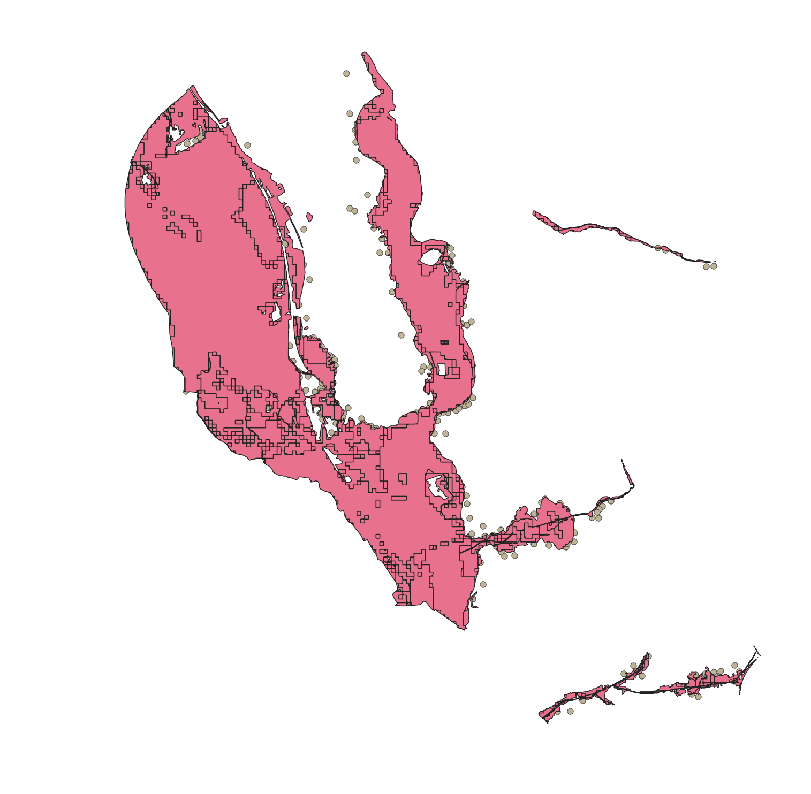

The next stage is to display the \`Flood Risk' layer, highlighting the likelihood of flooding. In order to do so, you need to familiarise yourself with the associated database: an **Attribute Table** and the metadata: ‘RoFRS_England_Product Description Files’ and then decide which field would be most sensible to map. Follow the steps below if unsure how to proceed:

-   Right click on the `Flood Risk` layer and select **Open Attribute Table**

-   A lookup for the column names can be found in the pdf file called “RoFRS_England_Product_Description”.

-   Decide which column would be the most appropriate to display the likelihood of flooding in Oxford.

-   Yes, we need to use the “`PROB_4BAND`” field, close the **Attribute Table**

-   Right click on the `Flood Risk` layer and go to its **Properties**

-   Within the **Symbology** Tab select **Categorized** from the drop down menu

-   Then, from the **Column** dropdown menu choose “prob_4band” and press the **Classify** button

-   You should see now four classes in the window ‘High’, ‘Medium’, ‘Low’ and ‘Very low’ (if there is an empty class, delete it by highlighting it and pressing **Delete** button)

-   Next, go to **Color ramp** and choose one of the gradient colour schemes e.g. ‘OrRd’ or ‘Blues’. Make sure to click the **Invert Color Ramp** box at the top of the Color ramp drop down menu.

-   Click Apply-OK\
    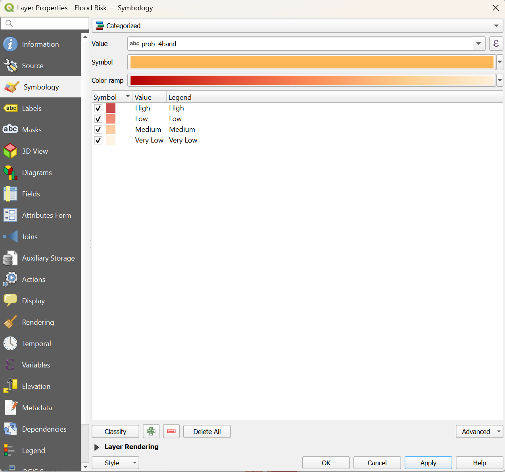{width="620"}

So by now, we have displayed the `Flood Risk` layer by the likelihood of flooding, with the dark red colour being associated with the highest risk and pale yellow with the lowest. We can however improve the map slightly with some additional adjustment to the layer style, and then we will be ready for further analysis.

-   Go to **Properties \> Symbology** of the `Flood Risk` layer and select the **Symbol** colour button from the drop down menu

-   Adjust the **Opacity** to 70% and remove the black borders by highlighting **Simple fill** and choosing **No Line** as your **Stroke style**

-   Click OK - Apply - OK.

    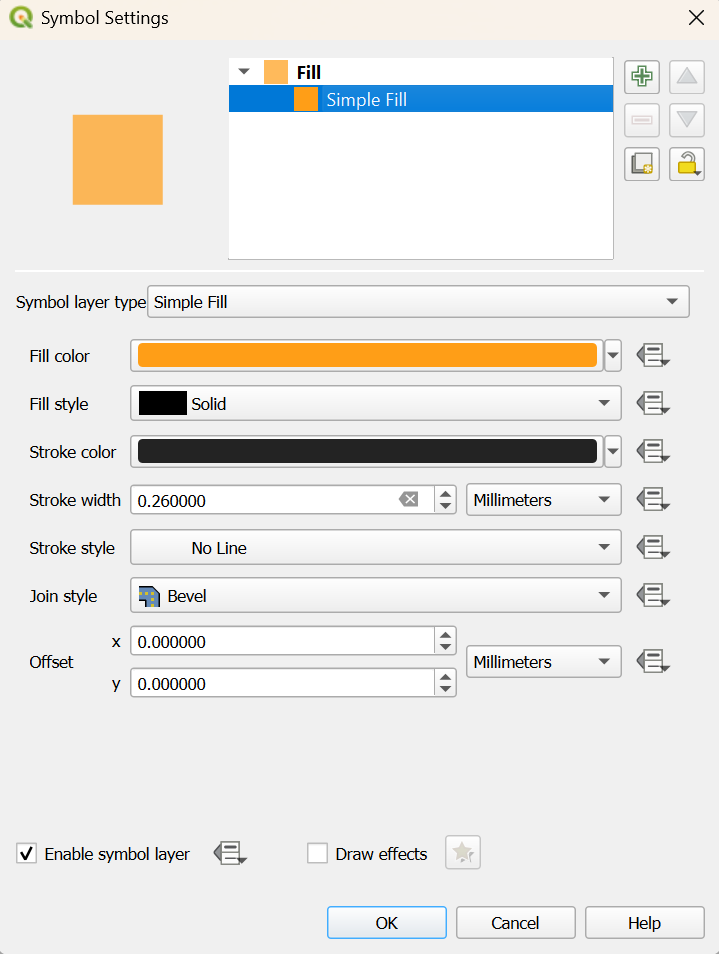{width="444"}

-   Now, using the same process try to style the point symbol for `Oxford Postcode`. Set the point size to **1.5**, colour to **green with white outline** and transparency/opacity at **75%**

-   Lastly, add some more layers from the ‘Oxford OS_data’ folder to your map. These should be: `ImportantBuilding`, `Railway Track`, `Road` and `SurfaceWater_Area`

-   Change the default symbols as you like, aiming at producing a good and informative map

When you’re finished with this task, your map should look something like the one below: 

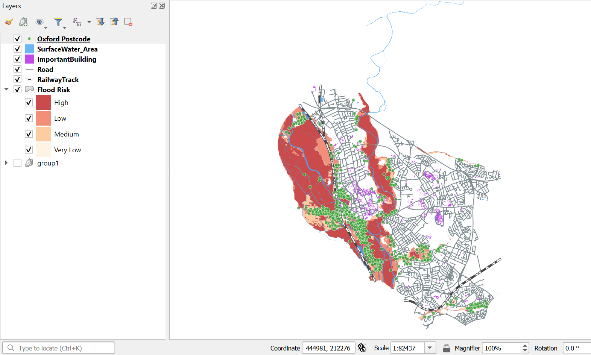

This map shows flood risk areas in Oxford, and highlights how the main risk of flooding to the city can be associated with out of bank spills from the River Cherwell and Thames and their tributaries. Furthermore, it can be noted that the flood risk area is relatively large and there is a high probability of some important buildings, roads and railway tracks being impacted.

### 2.3 Raster data (DEM)

It would also be useful to see how does the elevation model maps onto the flood risk zones. Typically, flood simulation models require information on the topography of the river channel and the adjacent floodplain. In the case of urban floodplains, the configuration and location of streets, buildings and other urban infrastructure is also required. So in this part of the practical we will explore various aspects of raster data based on DTM including displaying it, rendering the image, merging tiles, hillshades and conversions. We will also create a rough estimate of the extent of the floodplain based on the elevation data (the Environment Agency estimations are more accurate as they involve complex modelling so consider the following analysis as a GIS exercise..).

#### 2.3.1 Loading raster files

-   Go to your working directory and unzip the `Oxford_DTM` pack

-   Click on the **Add Raster Layer** button

-   Navigate to your *working directory \> Oxford_DTM \> sp*, select all files with .asc extension, drag and drop them into the **Layers Panel** (this may take a couple of minutes)

-   Group all raster layers, call them `Raster`

-   Explore the raster data, comment on the extent, resolution, tile size etc.

-   Play with the colours and other settings under the **Properties \> Symbology** tab

#### 2.3.2 Hillshade

A hillshade is a grayscale 3D representation of the surface, with the sun’s relative position taken into account for shading the image. This function uses the altitude and azimuth properties to specify the sun’s position. To add vertical exaggeration for visual effect we use Z factor.

-   Identify the SP50SW tile and turn off all the remaining raster tiles

-   Go to **Raster \> Analysis \> Hillshade…** (if the **Analysis** is not available go to **Plugins** and enable it)

-   Select the SP50SW tile as your **Input layer**

-   Keep the default value (1.0) for z factor

-   Save the file under the Hillshade heading to your Output folder and name the file appropriately (e.g. SP50SW Hillshade)

-   Hit **Run**, the new `Hillshade layer` should be added to the **Layers Panel** automatically

-   What is the difference between the new layer and the original tile?

-   Now change the z value to 5 and repeat these steps. Is there any difference?

#### 2.3.3 Merge raster tiles

As you probably have noticed, the raster DTM data comes in small tiles. It isn’t convenient to work with multiple tiles as you’d have to repeat the same steps over and over again. The easiest solution to this issue is to merge the tiles we need into a new layer. Follow the steps below:

-   **Raster \> Miscellaneous \> Merge**

-   Select all your Raster files within your QGIS Project as your **Input Files** (click … next to Input Files). Alternatively, click **Add File(s)** within the **Input Files** window and add the Raster files with .asc extension from the Oxford_DTM/Sp folder

-   Save the output to your working directory (this typically will be saved as a .tif file ), name it Oxford_DEM, click OK\
    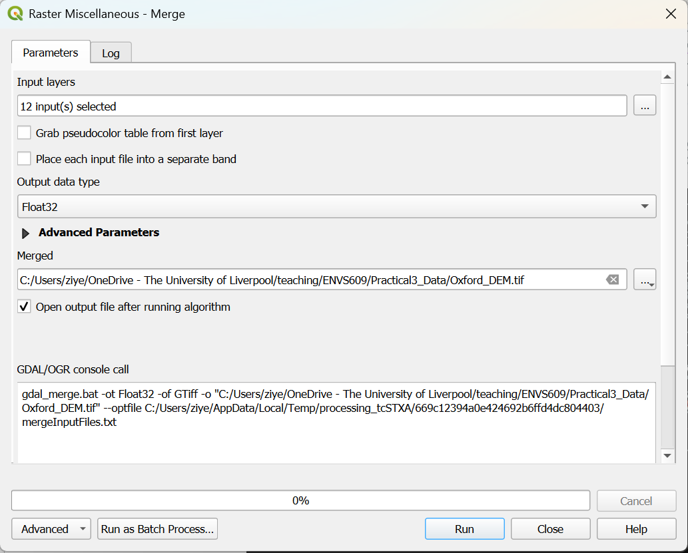

-   You should have by now all the raster tiles merged into one layer (if this is not the case please ask for help)

-   Remove all raster tiles from the **Layers Panel** - you won’t need them any longer

-   Next create a **Hillshade** of the **Oxford_DEM** file

-   Your output should look something like the one below: 

    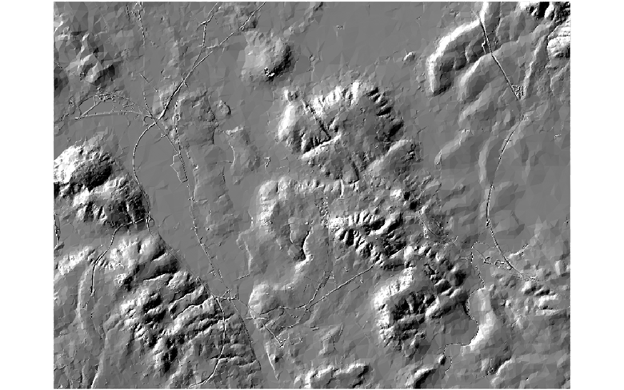

-   Adjust the transparency to 50% in the **Properties \> Transparency** tab

-   Overlay other useful layers e.g. `Flood risk` and `SurfaceWater_Area`

-   Is there any relationship between the elevation model and the extent of the flood risk identified by EA?

##### 2.3.3.1 Optional exercise

-   Using the **Analysis** tool, create Slope and Aspect output files for **Oxford_DEM**

-   What are the differences and what are they used for?

#### 2.3.4 Clip raster

In order to map only the area you need, the layer has to be clipped to an extent of a given vector layer - in our case the Oxford Borough boundaries. (Use the OS boundary file downloaded in Practical 2, section 2.5.3 to extract Oxford boundaries; <https://osdatahub.os.uk/downloads/open/BoundaryLine>) You may need to play with the brightness and contrast of the layer properties to get a good visualisation of the hill shade.

-   Go to **Raster \> Extraction \> Clip Raster by Mask Layer** and clip the **Oxford_DEM** or the **Hillshade** layer to the extent of Oxford borough district

-   You should be able to do it by yourself. If you’re experiencing any difficulties please go back to Practical 2, section 3.2, where the instructions on how to do it are provided

-   Compare your output against the one below, if your output is a square one, probably because you need to set the “Assign a specified nodata value to output bands [optional]” as -9999 and try the **Clip Raster by Mask Layer** again:

    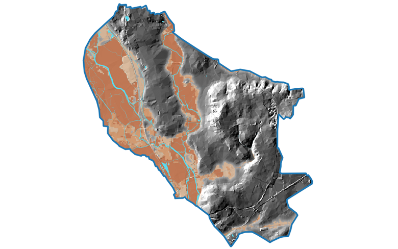

#### 2.3.5 Raster conversions

Often in GIS we need to convert data from vector to raster and from raster to vector. This is easy in QGIS and works well with the **Conversion** tool

-   Go to **Raster \> Conversion \> Polygonize (Raster to Vector)**

-   Use `Oxford_DEM` layer as the input file

-   Save the output to your working directory; name it `Oxford_vector_elevation`

-   Play with the colours and classification methods (use 5, 8 and 10 classes) until you have similar output to the one below: 

    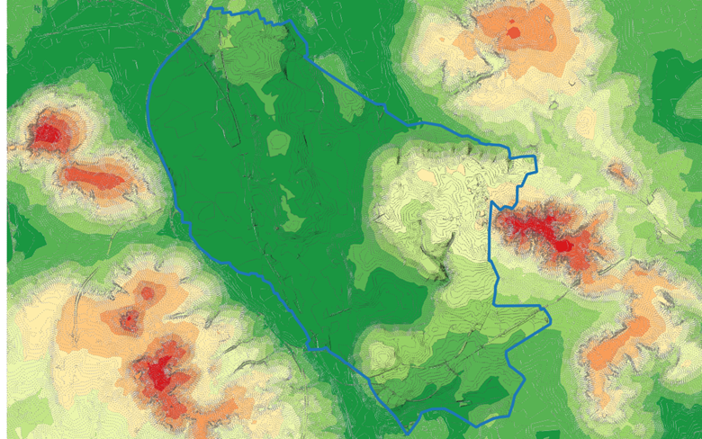

As you can see, this is very useful for visualisation purposes, the green colours are associated with the lower altitude and yellow and orange colours with higher altitude. The range varies from 50m to 194m. The areas which are more prone to flooding are those towards the lower end of this range. So now, let’s highlight the areas that are most likely to be flooded (based solely on elevation). This can be done easily by applying different colour scheme to those areas, for instance blue.

-   Go to the layer’s **Property \> Symbology** and adjust manually the lowest value of the `Oxford_vector_elevation` layer to 58 and make it blue

-   How does the blue area in your map compare to the EA flood risk areas

#### 2.3.6 Mask

In GIS, we often need to display only a part of a map or create a map for a particular area. So far, we have been using the **Clip** tool but there is another way of doing it, especially for the visualization purposes - creating a mask. Typically, it could be defined as a means of covering or hiding features on a map to enhance cartographic representation. In this exercise we will learn how to create a mask. Follow the steps below:

-   Go to **Plugins\> Manage and Install Plugins…** and type **Mask** in the Search window; select the **Mask** plugin and then click the **Install the Plugin** button

-   Select the *Oxford boundary* shapefile in the Layers Panel and then select the extent of Oxford borough using the **Select Features by…** tool (make sure that the entire extent of Oxford borough is highlighted - typically the highlighted features are displayed as bright yellow colour)

-   Go to **Plugins** and click on the **Mask** button then **Create a Mask**

-   Create Mask, you have an option to save it as an ESRI shapefile but you don’t have to do it

-   click OK

-   The mask should be added to the Layers Panel

-   Check different options available under **Properties \> Symbology** and choose one that you like

    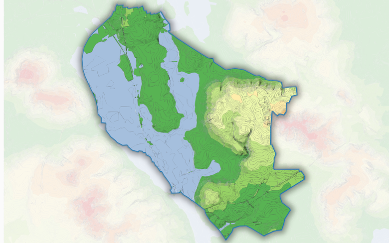

Mask

## 3 Practical – Part II (Week 6)

### 3.4 Analysis

By carrying out a GIS analysis we are able to provide some valuable insights on the exposure of people or protected buildings to flood risk. Also having more specific information such as what is the size of the potential flood risk area, what is the length of the potentially affected roads and railway tracks or how many residential properties are at high/medium/low risk may be useful for local authorities. Insurance companies often use a property-level GIS analysis to assess your property’s flooding risk and adjust the premium accordingly.

In this practical you will use a few simple GIS analysis techniques to provide empirical evidence for the Borough of Oxford. Firstly, you need to display all the roads, railway tracks and important buildings that are within areas at risk of being flooded; and secondly, you will need to calculate the size of the flood risk area and length of the affected roads and railway tracks.

This will first involve you selecting the features that are near areas of high flood risk. This is typically done using a function called **Select by Location**, where features in one layer are selected based on a spatial relationship to features in another layer. An alternative approach is to use **Geoprocessing Tools** such as **Clip**, **Union**, **Intersect** and **Dissolve**. You already have used most of these tools so it should be really easy to follow the exercise below.

#### 3.4.1 Select by Location

-   Go to **Research Tools** in the **Vector** menu

-   Choose **Select by Location**

-   In the dialog that appears select `Railway Track` from the field **Select features from:**. Then specify `Flood Risk` in the field below called: **By comparing to the features from:**

-   Leave “intersect” as your selection method, click **Run** and then the **Close** button

-   Then click on the **Zoom to Selection** button from the main toolbar {alt="Zoom_Select"} (If you get an error message, first go to the **Processing Toolbox Panel** (right-click anywhere above the QGIS canvas window to toggle on), search for the **Fix geometries** tool, then process the file in question (in our case this will be the `Flood Risk` layer. Resave the layer and use the one with fixed geometries for further analysis. If the problem still persist try the following: **Settings \> Options \> Processing and under General \> Invalid features filtering change to Skip (Ignore) features with invalid geometries**).

-   Now save the selected features. Right click *Railway Track \> Export \> Save Selected Features As…* Save the new file in your Output folder and name `Rail_Clip`

-   Then repeat for the Road, Important Building and Oxford Postcode layers; name them “`Road_Clip`”, “`ImpBuilding_Clip`” and “`Postcode_Clip`” respectively.

#### 3.4.2 Clip

An **alternative** method for saving the railway tracks within the flood risk zone is to use clip.

-   Go to **Geoprocessing tools** in the **Vector** menu and choose the **Clip** tool

-   In the dialog that appears select `Railway Track` as your **Input vector layer** and `Flood Risk` as your **Overlay layer**

-   Save the output in your working directory; name it: `Rail_Clip` and then click **Run**

-   A new layer will be added to your **Table of Contents**

-   Note that the clipped layer is entirely within the Flood Risk area

-   Render the image using the same steps as previously

-   Next, clip the **Road** and **Important Building** layers to the Flood Risk extent; name them “`Road_clip`” and “`ImpBuilding_Clip`” respectively

-   Lastly, clip your Oxford Postcode layer

Once all the shapefiles have been saved as permanent layers, you can calculate some basic statistics:

-   Go to **Vector menu \> Analysis Tools \> Basic statistics for fields** and obtain the statistics for Rail_Clip. Answer the questions below: o Is the extent of the selected features corresponding with the Flood Risk layer? o What is the length of the railway tracks potentially affected by the flood risk?

-   Repeat for the `Road_Clip` and then `ImpBuilding_Clip` layers

#### 3.4.3 Dissolve

Currently, we have over 1000 polygons in our `Flood Risk` layer. This might be slightly problematic if we wanted to calculate total area of the High, Medium, Low and Very Low flood risk zones. We’ll use the **Dissolve** tool to merge these polygons, based on the likelihood band.

-   Right click the `Flood Risk` layer and open the **Attribute table**

-   Scroll down and check how many composite polygons are there within the `Flood Risk` layer

Yes, there are 1090 polygons; however ideally we’d like to have it as four polygons, one for each flood risk band. This can be done with just a few clicks of your mouse…

-   Go to **Geoprocessing tools** in the **Vector** menu and choose **Dissolve**

-   In the dialog that appears select `Flood Risk` as your **Input vector layer**

-   Click … next to **Dissolve field(s)** and tick ‘prob_4band’ as your **Dissolve field**. Click OK

-   Save the output to your Output folder; name it `FRisk_dissolved`

-   Click OK. A new layer should be automatically added to the **Layers Panel**

-   Open the **Attribute table** of the newly created layer

-   How many polygons are there now?

-   Are they corresponding with the flood likelihood bands?

#### 3.4.4 Calculate geometry (area and length)

Polygon area and line features length can be calculated by a tool called **Field calculator**. It allows performing calculations on the basis of existing attribute values or defined functions. The results can either be saved to a new attribute or they can be used to update values in an already existing column. In this case we will calculate the area in hectares rather than in sqm.

-   Go to **Project \> Properties \> General** and change the units for area measurement to Hectares

-   Open the **Attribute table** of the `FRisk_dissolved` layer

-   Click on the **Toggle editing mode** button and then **Field calculator**

-   Make sure that the **Update existing field** is marked. This is because there is already a column called *Shape_Area* so we are going to update it, rather than create a new one

-   Choose ‘area’ from the drop down menu

-   Go to **Geometry** in the **Functions** field and double click on **\$area**

-   Click OK and then check the values in the ‘area’ column within the **Attribute table**; they should be updated now

-   Now delete all the columns between the ‘prob_4band’ and ‘area’ as they were made redundant by the **Dissolve** function. To do so, press the **Delete column** button {alt="TDeleteCol"} and select the required field from the **Delete Attributes** dialog

-   Press the **Toggle editing mode** button to stop editing

-   click on Save in the window that appears

-   What is the total area of the flood risk area in Oxford? If you wanted to check what measure units have been used, go to **Project** and choose **Properties**. Under the **General** tab there is a field called **Units for distance/area measurement**

Now we need to calculate total length of the roads that are within the flood risk area. This is done in a similar way as calculating an ‘area’. Give it a go; but in case you get stuck, have a look at the steps below:

-   Open **Attribute table** of the `Road_clip` layer, select **Toggle** mode and open the **Field calculator**

-   Make sure the **Create a new field** box is selected; name the new field *Length* and go to **Functions/Geometry** where you will find the **\$length** function

-   Double click the **\$length** function and then OK. Check that the **Length** field has been added to the **Attribute table**

In order to get total length of the roads within the flood risk area use the tool called **Basic statistics for Fields**. In case there any confusion, see the steps below:

-   Click on **Vector** then **Analysis Tools** and choose **Basic statistics for fields**

-   In the dialog that appears, specify “`Road_clip`” as the Input Vector layer

-   Choose ‘Length’ as your **Field to calculate statistics on**

-   Click Run. You should get results similar to these:

    

-   So the total length of the roads within the flood risk area is 135,460m.

-   If you wanted to check what measure units have been used, go to **Project** and choose **Properties**. Under the **General** tab there is a field called **Units for distance/area measurement**

-   By default it is set to meters but you can change it to e.g. ‘Feet’ or ‘Degree’

-   Now, get the total length of the Railway Tracks within the flood risk area by following the steps above

-   What’s the result?

Next, we’ll get the number of ‘Important Buildings’ that are within the flood risk area. In this case we also can use the **Basic statistics for fields** function or we can simply open the **Attribute table** and check how many rows there are. However, if we wanted to know how many Important Buildings are in the ‘High’ risk zone, it may be slightly more tricky. One of the easiest ways of doing it is to use the **Select by Location** tool. Follow the steps below:

-   First, select all High flood risk areas by opening the **Attribute table** of the `FRisk_dissolved` layer and then highlighting the corresponding polygon

-   For the purpose of this analysis it is enough to simply select the polygons in the **Attribute table**

-   However, if you wanted to create a separate layer showing the High Risk Flood areas, right click on the layer then **Export \> Save Selected Features As…** , specify your working directory

-   Click on **Vector** then **Research Tools** and choose **Select by Location**

-   In the dialog box that appears, specify the `ImpBldg_clip` as the selectable layer and `FRisk_dissolved` as the layer to intersect with

-   Make sure that the first and the last options are marked as per picture below:\
    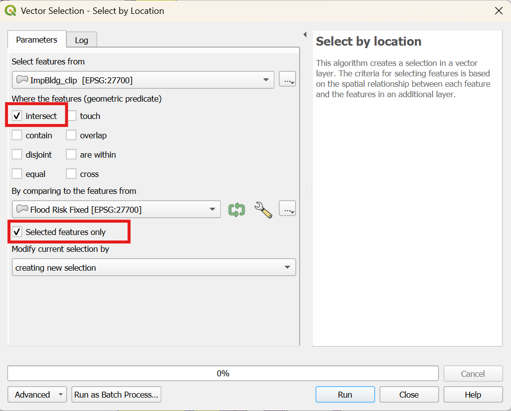

-   Now go to the **Attribute table** of `ImpBuilding_Clip` and check how many buildings have been selected.

-   What is the result?

Finally, let’s explore the `Oxford Postcode` data. It would be useful to know how many residential properties there are in each flood risk likelihood category. The easiest way of providing such information is to use two different tools, first we need to select the postcodes within each flood risk band and then use the **Basic Statistics** tool to obtain the required values.

-   Go to **Attribute table** of the `Flood Risk` layer or `FRisk_dissolved`

-   Select all the areas classified as *High* flood risk by creating a simple spatial query (SQL) or selecting the corresponding rows.

-   Next, go to the **Select by location** tool and select all the points (`Oxford postcode`) that intersect with the selected features of the `Flood risk` (or `FRisk_dissolved`) layer

-   In the final step go to the **Basic statistics for Fields** tool and choose `Oxford Postcode` as the **Input vector layer** and *`res_cnt_hi`* as your Target field **Field to calculate statistics on**, hit **OK**

-   Check now what is the *Sum* value for all residential properties in a *High* flood risk likelihood category

-   Now, we can conclude that in Oxford Borough there are 2006 Residential properties in a *High* flood risk likelihood category of which 1809 are located in the High Flood Risk area

-   Can you explain the discrepancy in the above values? (\*clue: postcode centroids)

-   Can you identify those postcode units that are in a *High* flood risk likelihood category but are not located in the High Flood Risk area?

-   Repeat this short analysis for other Flood Risk bands (use the EA data description guidelines if you are unsure what columns to analyse)

### 3.5 Mapping

Having done some basic spatial analysis, we need now to create some maps that can be printed or published. These maps will show various aspects of flood risk in Oxford. In this practical we will only create a general map depicting the roads and railway track likely to be affected by future flood events; however, the same principles apply to any map creation.

As you already know from the previous practicals, in QGIS the **Print Layout** is normally used to create maps. In order to make maps that are easily interpretable there are several things you need to be aware of such as the layout, level of generalisation, clarity of symbols, and perhaps above all, some understanding about what is the purpose of your map.\
In this practical you will enhance your skills of creating maps by exploring some of the additional options when adding your legend, scale bar, north arrow etc.

-   Display the `Flood Risk`, `Road_clip`, `Rail_clip` and `River` layers

-   Rename `Road_clip` layer to `Roads at risk` and `Rail_clip` to `Railway Track at Risk`

-   Open **Project \> New Project Layout…;** name it `Flood Risk`

-   A new blank window opens up; Change the orientation to **Portrait** under **Item Properties**

-   Go to **Add Item** and choose **Add map**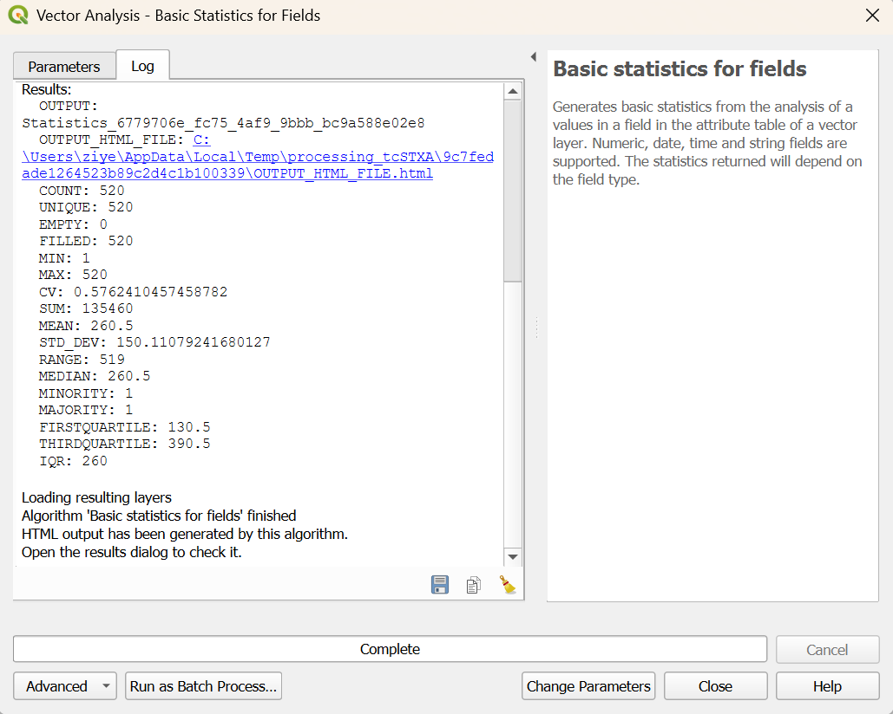

-   Adjust the scale to 45000 in the **Item properties** tab (try to experiment with different scales)

-   Next, go to **Add Item** and choose **Add legend** 

-   By default all items from the `Layers Panel` will be displayed. To remove any unwanted items click on the legend and then go to to **Item properties**

-   Uncheck the **Auto update** option and you will be able to delete any unwanted items by clicking the **“-”** sign located below the **Legend items** window

-   If you want to rename any of your layers you’ll have to do it within the `Layers Panel` (not in the **Print Layout**)

-   Now, change font size in the “Legend window”. In **Item properties** scroll down to **Fonts and Text Formatting**, select **Title font** and make it “Bold”. Repeat this for the **Subgroup font**

-   Then, add a scale bar by using the **Add Scalebar**  button

-   Play with its properties (e.g. change the number of segments, style and height available from the *Item properties* tab)

-   To add a North arrow select **Add Item \> Add North Arrow**

-   Draw the extent of the image

-   We are almost done with our map; all we need now is a nice title

-   Select **Add label** from the **Add Item** menu. Draw the extent on the map and type a title you wish in the **Main properties** window, then adjust the font etc.

-   Finally, export your map using the **Export as Image** button from **Layout** menu; hopefully it looks something like the one below:\
    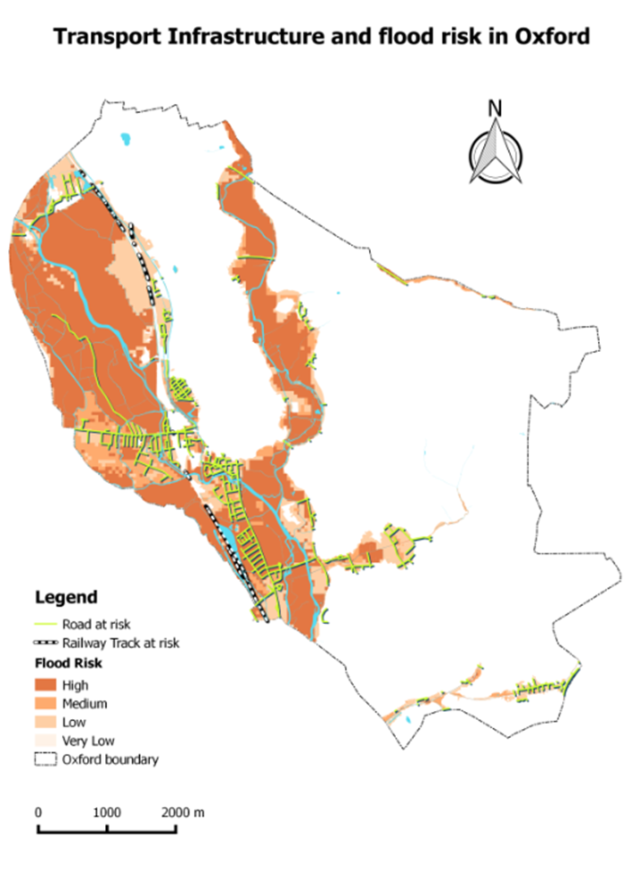{width="467"}

At times we need to create a “zoomed in” portion of the main map which is referred to as an `inset map`. This is normally used to show an overview area such as national or regional extent or extra detail for a particular study area. In this practical we will display those important buildings that are at risk of flooding associated with out of bank spills from the River Cherwell. The city level map does not show these buildings very clearly, so to address this issue we will produce a ‘zoomed in’ map. The easiest way to do it is using a **Zoom in** tool and saving the extent as an image from the **Project** menu. A more professional approach however, involves creating an inset map in the **Print Layout**. Follow the steps below.

-   Make sure that in the main QGIS interface only the following layers are marked: `Flood risk`, `River`, `surface water` and `Important buildings at risk`. If you wish, you may also use the `Oxford boundary` layer.

-   Go to your **Print Composer**. Click on the Map (or click Map 1 in the **Items Panel**). In the **Main Properties**, untick and retick the **Draw map canvas items** button to update the map within the **Print Layout**

-   Adjust your legend in **Items properties** by removing the redundant layers like before

-   Next, add a new, smaller map in the top right corner on top of the other map using the steps from above

-   In the smaller map, zoom in to the ‘Cherwell River’ area; set scale to something appropriate e.g. 1:12500

-   Click on your inset map and go to the **Item properties** tab

-   Scroll down to **Overviews** and click on the ‘+’ sign

-   Choose *Map 1* as your **Map frame**

-   Set the colour to transparent within **Frame style** and use ‘Solid line’ as your border style

-   Then click on the large map and go to the **Item properties** tab

-   Scroll down to **Overviews** again and click on the ‘+’ sign

-   This time choose *Map 2* as your **Map frame**

-   Adjust your **Frame style** so it matches the inset map

-   Change the title to ‘Important Building at flood risk in Oxford’

-   Your map is ready now and should look something like the one below:\
    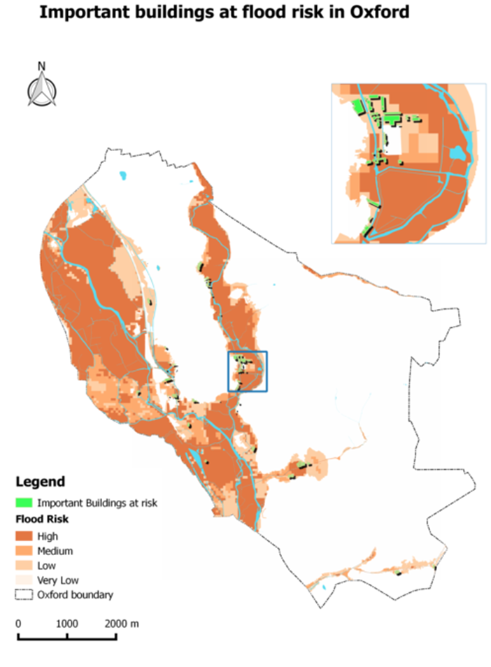{width="500"}

-   Save both the project in Print Composer and the main QGIS map

##### 3.5.0.1 Optional

-   Create a couple of different maps showing raster data and the vectorised elevation model

-   Use the `Mask` layer

-   Well done, you’re finished with the Flood Risk practical! You can relax now, there is no assignment till week 11 ;)
